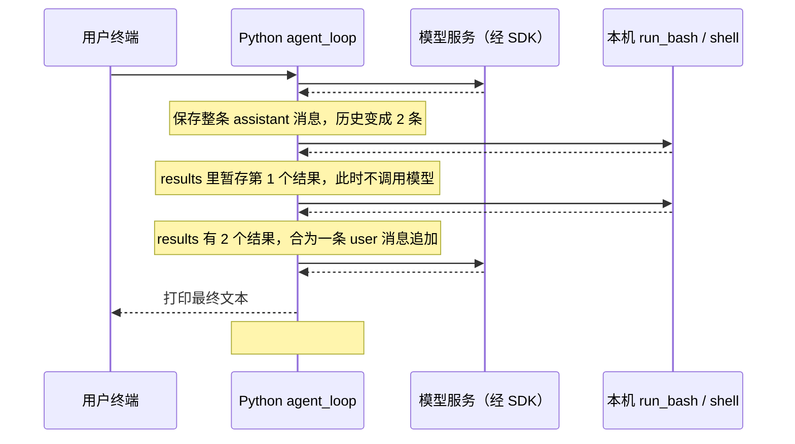

# s01 真实案例：消息如何传递，两个工具请求如何一起回传

本文已更新为最新 s01 录制中的问题：

> 请你告诉我当前路径下的文件夹个数有几个,分别是什么，如果有s01_agent_loop这个文件夹的话,帮我查看code.py中的前5行代码

证据来源：[本次原始录制](../visualizer/traces/s01-1793721257470446000.jsonl)、[s01 源码](code.py)、[录制器](../visualizer/record.py)。下文的 #编号对应 JSONL 事件的 `id`，不是消息数组索引。分析基于已有记录，没有重新执行命令或调用模型。

此前“第 10 个文件前三行”的分析已由本案例替换。旧录制仍保留在 [原录制文件](../visualizer/traces/s01-1793720235365041000.jsonl) 中。本文只分析最新会话，不把其他会话的历史拼接进来。

## 1. 本次发生了什么

- 用户输入 1 次问题。
- 模型被调用 2 次。
- 第一次模型响应同时包含 2 个 `tool_use`：一个统计并列出文件夹，另一个读取代码前 5 行。
- Python 按顺序执行 2 次 `run_bash`，不是并行执行。
- 两份结果作为同一条 user 消息中的 2 个 `tool_result`，一起发给第二次模型调用。
- 第二次模型响应给出最终答案，无工具请求；程序回到等待输入状态。

当时的结果：当前目录第一层有 **27 个目录，包含 4 个隐藏目录**；去掉这 4 个，剩 **23 个可见目录**。`s01_agent_loop/code.py` 存在，读取了前 5 行，其中第 4 行为空行。

本次请求里的模型名是 `deepseek-flash`。虽然程序使用 Anthropic Python SDK，实际模型以请求参数为准。记录未包含实际 HTTP 目标地址，不能仅凭模型名确定服务提供方。

## 2. 先看消息传递全图



模型返回的是“希望执行什么”的结构化请求。Python 才负责执行本地操作，并将结果装入下一次请求。网页读取录制文件展示这个过程，不执行这里的 shell 命令。

## 3. 输入怎样进入模型：事件 #3 → #4

`input()` 从终端读取你的问题，`s01 >>` 只是提示符，不属于问题文本。随后执行：

```python
history.append({"role": "user", "content": query})
agent_loop(history)
```

`agent_loop(messages)` 的 `messages` 和外面的 `history` 引用同一个 Python 列表。对 `messages` 追加内容，也是在更新 `history`。

事件 #4 是第一次 `client.messages.create(...)` 的实际参数快照：

```json
{
  "model": "deepseek-flash",
  "system": "You are a coding agent at /Users/jackie137/Desktop/Learn-Claude Code/learn-claude-code. Environment: Unix-like: the bash tool runs the system shell. Use bash to solve tasks. Act, don't explain.",
  "messages": [
    {
      "role": "user",
      "content": "请你告诉我当前路径下的文件夹个数有几个,分别是什么，如果有s01_agent_loop这个文件夹的话,帮我查看code.py中的前5行代码"
    }
  ],
  "tools": [
    {
      "name": "bash",
      "description": "Run a shell command.",
      "input_schema": {
        "type": "object",
        "properties": {
          "command": {
            "type": "string"
          }
        },
        "required": [
          "command"
        ]
      }
    }
  ],
  "max_tokens": 8000
}
```

| 参数 | 含义 |
|---|---|
| `model` | 选择本次模型 |
| `system` | 角色、当前目录与使用 bash 的要求；单独传入，不占 messages 的一条 |
| `messages` | 当前对话历史，此刻只有人的问题 |
| `tools` | 告诉模型有哪些工具、需要什么参数；这里仅有 bash |
| `max_tokens` | 本次输出 token 上限，不是实际使用量，也不是消息条数 |

`tools` 传入的是工具说明和参数格式，不是 `run_bash` 的 Python 实现。第一次请求也没有自动附带文件列表或文件内容。

实际传递路径为：Python 参数 → SDK 构造并发送请求 → 模型服务 → SDK 返回响应对象。当前代码使用同步、非流式 `create()`，返回前会等待，返回后才执行下面的工具逻辑。

录制器只记录 SDK 调用边界，不是 HTTP 抓包。请求头、服务端内部过程和 SDK 重试次数不在本案例的可见事件中。

## 4. 一个模型响应为什么能调用两个工具：事件 #5

事件 #5 的 `stop_reason` 是 `tool_use`。`response.content` 是一个内容块列表，本次其中有两个工具请求，两个请求都叫 `bash`，但 `id` 和 `input.command` 不同。

以下是两个实际 `tool_use` 块，保持原始顺序：

```json
[
  {
    "id": "call_00_1OrrjDpJz9ck1fZBBkRL3481",
    "caller": null,
    "input": {
      "command": "cd \"/Users/jackie137/Desktop/Learn-Claude Code/learn-claude-code\" && echo \"=== DIRS COUNT ===\" && find . -maxdepth 1 -type d ! -name \".\" | wc -l && echo \"=== DIR LIST ===\" && find . -maxdepth 1 -type d ! -name \".\" -exec basename {} \\; | sort"
    },
    "name": "bash",
    "type": "tool_use",
    "toolset_name": null
  },
  {
    "id": "call_01_hRVthDJAdoVU3SpHJSim4593",
    "caller": null,
    "input": {
      "command": "cd \"/Users/jackie137/Desktop/Learn-Claude Code/learn-claude-code\" && if [ -f s01_agent_loop/code.py ]; then echo \"=== s01_agent_loop/code.py first 5 lines ===\"; head -5 s01_agent_loop/code.py; else echo \"no s01_agent_loop/code.py\"; ls -la; fi"
    },
    "name": "bash",
    "type": "tool_use",
    "toolset_name": null
  }
]
```

这里没有发生第二次模型调用。两个请求在同一份响应中就已经给出，因此第二条读取文件的命令并不是模型看到第一个工具结果后才生成的。它通过自己的 `if [ -f ... ]` 在执行时判断文件是否存在。

响应还包含 `thinking` 类型块；本文不展开其内容，也不依赖它来解释过程。源码会将整个 `response.content` 保留到历史，包括这些内容块；只有 `type == "tool_use"` 的块进入工具执行列表。

先执行：

```python
messages.append({"role": "assistant", "content": response.content})
tool_calls = [
    block for block in response.content if block.type == "tool_use"
]
```

此时 `messages` 有 2 条，`tool_calls` 有 2 个元素。**消息条数与内容块数量不同：两个工具请求仍属于一条 assistant 消息。**

保存的是 `response.content`，不是整个响应对象。因此外层的 `usage`、`stop_reason`、响应 ID 不会通过这行代码进入历史；工具内容块中的 `id` 则会保留。

## 5. 第一个工具：统计目录，事件 #6 → #7

事件 #6 进入 `run_bash`，执行的命令字符串是：

```bash
cd "/Users/jackie137/Desktop/Learn-Claude Code/learn-claude-code" && echo "=== DIRS COUNT ===" && find . -maxdepth 1 -type d ! -name "." | wc -l && echo "=== DIR LIST ===" && find . -maxdepth 1 -type d ! -name "." -exec basename {} \; | sort
```

命令各部分的作用：

| 片段 | 作用 |
|---|---|
| `cd "..."` | 在这次子 shell 中进入项目目录；引号处理路径中的空格 |
| `find . -maxdepth 1` | 只检查当前目录本身及直接子项，不递归统计更深层目录 |
| `-type d` | 仅选择目录；按本次命令默认方式，不跟随符号链接来扩展目录范围 |
| `! -name "."` | 排除当前目录 `.` 自身 |
| `wc -l` | 计算输出行数，得到目录数量 |
| `-exec basename {} \;` | 对每个找到的目录提取名称；`{}` 是匹配路径占位符，转义的分号结束 find 的 exec 参数 |
| `sort` | 对目录名排序，未显式指定 `LC_ALL=C`，使用环境默认排序规则 |
| `echo` | 添加输出标签，不是文件内容 |

`find` 没有排除隐藏目录，因此 `.git` 等也计入。`&&` 表示前一命令或管道成功后才继续下一部分；`|` 是 shell 管道，把前一程序的标准输出交给后一程序。

计数与列表来自两次 `find`，不是一个共享快照。此次记录中，数量与列表一致，均为 27。它们都属于同一个 `run_bash` 调用。

事件 #7 的完整返回字符串：

```text
=== DIRS COUNT ===
      27
=== DIR LIST ===
.git
.github
.venv
.vscode
agents
docs
s01_agent_loop
s02_tool_use
s03_permission
s04_hooks
s05_todo_write
s06_subagent
s07_skill_loading
s08_context_compact
s09_memory
s10_task_system
s11_background_tasks
s12_cron_scheduler
s13_agent_teams
s14_mcp_plugin
s15_integrated_harness
s16_workflow_runtime
s17_goal_loop
skills
tests
visualizer
web
```

此时 Python 执行 `results.append(...)`，把第一个结果暂存到本地 `results` 列表。**尚未把结果发送给模型，也尚未追加承载结果的 user 消息**，因为 `for block in tool_calls` 还要继续执行第二个工具。

## 6. 第二个工具：读取前五行，事件 #8 → #9

事件 #8 执行：

```bash
cd "/Users/jackie137/Desktop/Learn-Claude Code/learn-claude-code" && if [ -f s01_agent_loop/code.py ]; then echo "=== s01_agent_loop/code.py first 5 lines ==="; head -5 s01_agent_loop/code.py; else echo "no s01_agent_loop/code.py"; ls -la; fi
```

- `[ -f s01_agent_loop/code.py ]` 检查目标是否为普通文件；它直接检查完整路径，没有先依赖第一个工具的目录列表。
- 条件满足时，打印标签，然后 `head -5` 读取前 5 行。
- 条件不满足时，才会打印不存在的提示并执行 `ls -la`。本次走的是条件满足分支。

事件 #9 的完整返回字符串：

```text
=== s01_agent_loop/code.py first 5 lines ===
#!/usr/bin/env python3
"""
s01_agent_loop.py - The Agent Loop

The entire secret of an AI coding agent in one pattern:
```

输出里的 `=== s01_agent_loop/code.py first 5 lines ===` 是额外标签，不计入文件行数。实际文件前五行是：

| 文件行号 | 内容 |
|---|---|
| 1 | `#!/usr/bin/env python3` |
| 2 | `"""` |
| 3 | `s01_agent_loop.py - The Agent Loop` |
| 4 | 空行 |
| 5 | `The entire secret of an AI coding agent in one pattern:` |

这不是“前五行非空代码”：空行和文档字符串都计入文件行数。

## 7. run_bash 如何把操作变成字符串

两个调用都使用相同的函数实现：

```python
r = subprocess.run(
    command, shell=True, cwd=os.getcwd(),
    capture_output=True, text=True, errors="replace", timeout=120,
)
out = (r.stdout + r.stderr).strip()
return out[:50000] if out else "(no output)"
```

执行前还有危险命令片段检查；部分异常会转成 `Error: ...` 字符串。本例两个工具都有正常文本输出，没有观察到错误事件。

- `shell=True` 让本机 shell 解释管道、条件、分号和重定向等语法。工具名叫 bash，但代码没有显式指定 Bash 可执行文件。
- `capture_output=True` 将 stdout/stderr 收进 Python，而不是让模型直接接收进程输出。
- `stdout + stderr` 先放标准输出再放标准错误，不保留两者交错发生的时间顺序。
- `strip()` 去掉整段输出首尾空白；内部空行仍保留。结果最多返回 50,000 个字符。
- `print(output[:200])` 只限制终端预览；传给模型的 `output` 没有在这里被截成 200 个字符。本例两份结果都未触及 50,000 字符上限。
- 代码没有将 `r.returncode` 单独写进 `tool_result`。

每次 `run_bash` 都新建子进程。命令中的 `cd` 只影响该次子 shell，不改变父 Python 进程目录。

本次 #7 返回后才发生 #8 调用，符合源码 `for` 循环的顺序执行逻辑；两个事件的毫秒显示值相同，不意味着它们并行。

## 8. 两个结果如何一起回传：事件 #9 → #10

核心代码如下：

```python
results = []
for block in tool_calls:
    output = run_bash(block.input["command"])
    print(output[:200])
    results.append({
        "type": "tool_result",
        "tool_use_id": block.id,
        "content": output,
    })

messages.append({"role": "user", "content": results})
```

注意最后一个 `messages.append(...)` 在 `for` 外面。两次执行结束后，`results` 有 2 个元素，但只追加 **1 条** user 消息。这条消息的真实结构如下：

```json
{
  "role": "user",
  "content": [
    {
      "type": "tool_result",
      "tool_use_id": "call_00_1OrrjDpJz9ck1fZBBkRL3481",
      "content": "=== DIRS COUNT ===\n      27\n=== DIR LIST ===\n.git\n.github\n.venv\n.vscode\nagents\ndocs\ns01_agent_loop\ns02_tool_use\ns03_permission\ns04_hooks\ns05_todo_write\ns06_subagent\ns07_skill_loading\ns08_context_compact\ns09_memory\ns10_task_system\ns11_background_tasks\ns12_cron_scheduler\ns13_agent_teams\ns14_mcp_plugin\ns15_integrated_harness\ns16_workflow_runtime\ns17_goal_loop\nskills\ntests\nvisualizer\nweb"
    },
    {
      "type": "tool_result",
      "tool_use_id": "call_01_hRVthDJAdoVU3SpHJSim4593",
      "content": "=== s01_agent_loop/code.py first 5 lines ===\n#!/usr/bin/env python3\n\"\"\"\ns01_agent_loop.py - The Agent Loop\n\nThe entire secret of an AI coding agent in one pattern:"
    }
  ]
}
```

这条消息中的 `role="user"` 由程序生成，并不表示人又输入了一次问题。工具结果按当前 Messages 协议格式放在 user 消息里；`content` 是一个列表，列表内每个 `tool_result.content` 才是具体的工具输出字符串。

`messages.append` 只是改变 Python 内存中的列表。**真正把两份结果发送给模型的是接下来事件 #10 的 `client.messages.create(...)`。**

第二次请求中的完整历史可以这样读：

```text
messages[0]  role=user
  content：人的原始问题

messages[1]  role=assistant
  content：首次模型响应的全部内容块
    其中 tool_use 1：请求统计目录
    其中 tool_use 2：请求读取文件

messages[2]  role=user
  content：程序打包的工具结果列表
    tool_result 1：27 个目录及名称
    tool_result 2：code.py 前 5 行
```

第二次请求依然传入完整 `messages`，以及和第一轮一致的 `model/system/tools/max_tokens`。它不是只发送新结果，也不是依靠某个响应 ID 让服务端自动补齐历史。

## 9. 工具 ID 和请求 ID 如何配对

| 标识 | 本次具体用途 |
|---|---|
| 事件 `id` | #1～#12：定位录制中的事件顺序 |
| 录制器 `call_id` | 连接同一次 SDK 请求与响应，不是工具 ID，也不在发给模型的 payload 中 |
| `tool_use.id` | 模型返回的工具请求标识 |
| `tool_result.tool_use_id` | Python 复制对应的 `block.id`，标明结果属于哪个工具请求 |

两次模型调用：

| 请求事件 | 响应事件 | call_id | 请求消息数 | stop_reason |
|---|---|---|---:|---|
| #4 | #5 | `e732ac3dc470` | 1 | `tool_use` |
| #10 | #11 | `d699be2d9357` | 3 | `end_turn` |

两个工具调用：

| 工具 | tool_use.id = tool_result.tool_use_id | 本地执行事件 | 结果发送事件 |
|---|---|---|---|
| 1 | `call_00_1OrrjDpJz9ck1fZBBkRL3481` | #6 → #7 | #10 |
| 2 | `call_01_hRVthDJAdoVU3SpHJSim4593` | #8 → #9 | #10 |

模型收到第二次请求时，可以通过工具 ID 明确区分哪个字符串来自目录统计，哪个来自文件读取。原始响应外层的 `id` 是另一个标识，不应与工具 ID 混用。

函数事件还记录了辅助 `frame_id`，表示本地 Python 函数帧；它不是模型工具调用 ID，也不能当成跨整个会话永久唯一的标识。本次函数事件没有 `call_id`，工具执行发生在 SDK 返回之后。

## 10. 第二次响应如何结束循环：事件 #11 → #12

事件 #11 的 `stop_reason` 是 `end_turn`，内容中没有 `tool_use`。程序先保存最终 assistant 消息，再筛选工具请求；发现列表为空，`agent_loop` 返回。

**源码直接检查的是 `if not tool_calls`，不是 `if stop_reason == "end_turn"`。**

主程序随后从 `history[-1]["content"]` 选出 `text` 块打印。事件 #12 再次等待终端输入；这是本轮回答结束，不表示进程已退出。读取记录时，本次文件还没有 `session_end`。

最终历史有 4 条：

```text
0 user       原始提问
1 assistant  一次响应：两个工具请求（以及响应中的其他内容块）
2 user       一条回传消息：两个工具结果
3 assistant  最终回答
```

因此消息数量变化是：**输入后 1 条 → 保存首次响应后 2 条 → 加入结果后 3 条 → 保存最终回答后 4 条**。真正发送给模型的两次快照分别只有 1 条和 3 条。

事件 #11 的最终文本原文如下：

````markdown
当前路径：`/Users/jackie137/Desktop/Learn-Claude Code/learn-claude-code`

## 文件夹个数：27 个（含隐藏目录）

`.git`、`.github`、`.venv`、`.vscode`、`agents`、`docs`、`s01_agent_loop`、`s02_tool_use`、`s03_permission`、`s04_hooks`、`s05_todo_write`、`s06_subagent`、`s07_skill_loading`、`s08_context_compact`、`s09_memory`、`s10_task_system`、`s11_background_tasks`、`s12_cron_scheduler`、`s13_agent_teams`、`s14_mcp_plugin`、`s15_integrated_harness`、`s16_workflow_runtime`、`s17_goal_loop`、`skills`、`tests`、`visualizer`、`web`

如果只算可见业务目录（排除 `.git`/`.github`/`.venv`/`.vscode`），则是 **23 个**。

## `s01_agent_loop/code.py` 前 5 行

```python
#!/usr/bin/env python3
"""
s01_agent_loop.py - The Agent Loop

The entire secret of an AI coding agent in one pattern:
```
````

## 11. 如何判断这次回答是否有依据

- “27 个目录”来自工具 1 的计数和 27 个名称，两者一致；范围是当前目录第一层，包含隐藏目录，排除 `.` 自身。
- “23 个可见目录”由 27 减去 `.git`、`.github`、`.venv`、`.vscode` 这 4 个隐藏目录得出，没有额外调用一次工具。回答中的“业务目录”只是描述用语，命令并未判断业务属性。
- `s01_agent_loop` 出现在目录列表中；工具 2 又检查了 `s01_agent_loop/code.py` 是否为文件并读取文本。
- 回答中展示的五行与工具返回一致，空行是第 4 行。

与旧案例不同，这次用户明确问文件夹，模型使用 `find -type d`，没有把普通文件和目录混排后挑第 10 项。命令结果反映录制时刻；以后新增目录，计数可能改变。

## 12. 在网页中怎样跟着看

网页选择 **s01 → 真实记录**，确认文件名为 `s01-1793721257470446000.jsonl`。页面读取本章最新录制；若之后又启动新录制，页面可能切换到新文件。

关闭“跟随新事件”，按顺序查看：

| 事件 | 查看位置 | 重点 |
|---|---|---|
| #3 | 消息 / 参数 | 人的原始问题 |
| #4 | 消息 / 参数、上下文 | 1 条 messages，另外有 system 和 tools |
| #5 | 消息 / 参数 | 一次响应中的 2 个 tool_use，不是 2 条 assistant 消息 |
| #6、#7 | 消息 / 参数、对应源码 | 工具 1 的输入、完整输出 |
| #8、#9 | 消息 / 参数、对应源码 | 工具 2 的输入、完整输出；中间没有模型请求 |
| #10 | 上下文 | 3 条消息；最后一条 user 的 content 包含 2 个 tool_result |
| #11 | 消息 / 参数 | 最终 text、end_turn、无工具请求 |
| #12 | 消息 / 参数 | 回到等待输入 |

“上下文”展示的是模型请求快照：选中 #5～#9 时，最近的请求仍是 #4，因此不能在这里期待看到新增结果后的历史；要看结果回传后的 3 条消息，应选择 #10。选中 #11 时，上下文是 #10 的 3 条输入，最终回答追加后的第 4 条没有新的请求快照。

录制器不为每个 `messages.append()` 单独生成事件。本文对这些内存操作的解释来自源码，并由后续请求快照验证；它们不是额外捕获到的时间线事件。

## 13. 全部事件与耗时

时间是录制开始后的累计秒数，不是每一步耗时。#3 之前的大部分时间是在等待用户输入，不是模型处理耗时。

| 事件 | 累计秒数 | 类型 | 方向 | 含义 |
|---|---:|---|---|---|
| #1 | 0.638 | `session_start` | runtime → agent | 真实录制开始 |
| #2 | 0.832 | `input_wait` | agent → user | 等待终端输入 |
| #3 | 124.494 | `user_input` | user → agent | 用户输入 / 确认 |
| #4 | 124.501 | `llm_request` | agent → llm | 发送 LLM 请求 |
| #5 | 126.267 | `llm_response` | llm → agent | 收到 LLM 响应 |
| #6 | 126.269 | `function_call` | agent → tool | run_bash() 调用 |
| #7 | 126.352 | `function_return` | tool → agent | run_bash() 返回 |
| #8 | 126.352 | `function_call` | agent → tool | run_bash() 调用 |
| #9 | 126.366 | `function_return` | tool → agent | run_bash() 返回 |
| #10 | 126.368 | `llm_request` | agent → llm | 发送 LLM 请求 |
| #11 | 128.008 | `llm_response` | llm → agent | 收到 LLM 响应 |
| #12 | 128.010 | `input_wait` | agent → user | 等待终端输入 |

从用户输入 #3 到最终响应 #11，约 **3.514 秒**。两次 SDK 调用的观测时长分别约 1.766 秒、1.640 秒；两次工具函数边界之间分别约 0.083 秒、0.014 秒。这些是该次录制的近似时长，不等于纯网络耗时，也不是未来运行的固定时长。

## 14. 对照源码阅读

下列为更新文档时 `s01_agent_loop/code.py` 的行号，后续编辑可能导致变化：

| 行号 | 作用 |
|---|---|
| 64–65 | 创建客户端、读取模型名 |
| 76–93 | 定义 system prompt 和工具说明 |
| 97–114 | run_bash 执行与输出处理 |
| 123–126 | 请求模型并等待响应 |
| 129 | 保存 assistant 内容 |
| 133–137 | 筛选工具请求；没有请求就返回 |
| 140 | 创建本轮 results 列表 |
| 143–151 | 顺序执行所有工具并逐个收集结果 |
| 154 | 循环结束后，将所有结果合为一条 user 消息 |
| 175–176 | 保存人的输入，进入 agent_loop |
| 178–182 | 打印最终文本 |

本次证据核对已完成：两次请求的固定参数一致；首轮 assistant 内容完整进入第二次请求；两个 command 与实际函数入参一致；两个函数返回字符串与下一次请求里的 tool_result.content 一致；两组工具 ID 正确配对。
