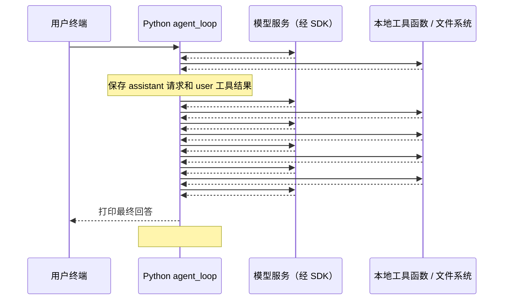

# s02 Tool Use 真实案例：glob → read_file → write_file 的信息流

本文分析以下用户问题在 `s02_tool_use/code.py` 中的实际执行过程：

> 请按顺序完成：先用 glob 查找 s02_tool_use/demo 下的所有 Python 文件； 再用 read_file 读取其中的 greeting.py； 最后用 write_file 将读取到的完整内容写入到s02_tool_use/demo/greeting_copy.txt。 每一步完成后再进行下一步。

依据：[本次真实录制](../visualizer/traces/s02-1793780832243202000.jsonl)、[s02 源码](code.py)、[录制器](../visualizer/record.py)、[可视化说明](../visualizer/README.md)。本文的 `#编号` 对应录制事件的 `id`，不是 `messages` 的下标。分析使用已有记录，没有重新调用模型或执行录制中的写入命令。

## 1. 这次实际执行了什么

用户只输入了一次完整问题。模型先后请求 `glob`、`read_file`、`write_file`，每次都在收到前一个工具的结果后才生成下一个请求，符合“每一步完成后再进行下一步”。

不过，真实执行并未在第三个工具结束后立即停止：模型写入的内容比读取结果多了一个末尾换行，于是又请求两次 `bash`，先检查差异，再修正并验证。

| 项目 | 本次记录 |
|---|---|
| 人的输入 | 1 条，事件 #3 |
| 模型调用 | 6 次，每次都有一份请求和响应 |
| 工具调用 | 5 次：glob → read_file → write_file → bash → bash |
| 每次响应中的工具请求数 | 前 5 次各 1 个，最后一次为 0 个 |
| 最终历史消息数 | 12 条 |
| 找到的 Python 文件 | `s02_tool_use/demo/greeting.py` |
| 最终文件内容 | 两个文件均为 `print("Hello")`，14 字节，末尾无换行 |

**本例的核心是：工具结果先进入消息历史，再随下一次请求交给模型；下一个工具的参数由模型生成。** Python 没有预先写好“搜索后自动读取，再把读取变量直接传给写入”的三步流程。

## 2. 完整信息流图



图里的模型负责返回结构化工具请求，本地 Python 负责实际读写文件。可视化程序记录并展示这些边界，不替模型执行工具。

## 3. 用户问题怎样进入第一次模型请求：#3 → #4

主程序接收输入后执行：

```python
history.append({"role": "user", "content": query})
agent_loop(history)
```

此时 `history` 只有一条 user 消息，`content` 是完整问题字符串。`agent_loop(messages)` 中的 `messages` 与外面的 `history` 引用同一个列表，因此循环里追加消息也会更新 `history`。

随后进入 `while True`，发送：

```python
response = client.messages.create(
    model=MODEL,
    system=SYSTEM,
    messages=messages,
    tools=TOOLS,
    max_tokens=8000,
)
```

事件 #4 记录了本次实际参数：

| 参数 | 本次值或作用 |
|---|---|
| `model` | `deepseek-flash` |
| `system` | 说明当前工作目录、Unix-like 环境，以及使用工具完成任务 |
| `messages` | 目前只有用户问题；尚无目录列表和文件内容 |
| `tools` | bash、read_file、write_file、edit_file、glob 的名称、说明和参数 Schema |
| `max_tokens` | 8000，是输出 token 上限，不是历史条数 |

本次 `system` 中的工作目录是 `/Users/jackie137/Desktop/Learn-Claude Code/learn-claude-code`。相对路径按这个目录解释，而不是按 `code.py` 所在目录解释，因为代码使用 `WORKDIR = Path.cwd()`。

`system`、`tools` 是单独的请求参数，不占 `messages` 的消息条数。工具说明会随每一次模型请求发送，传入的不是工具函数源码，也不是 Python 函数对象。

程序使用 Anthropic SDK，但实际请求的模型名以记录中的 `model` 为准。这里的可视化记录是 SDK 调用边界快照，不是 HTTP 抓包，也不展示模型内部决策过程。

## 4. 第一步：glob 查找 Python 文件，#5 → #8

### 4.1 模型返回工具请求：#5

第一次响应包含 thinking、text、tool_use 三种内容块。本文只分析对外文本和工具请求，不展开 thinking 内容；后面的时序图和历史简图也省略 thinking 块。源码保存的是完整 `response.content`，因此这些块仍会保留在历史中。

其中 text 是“我先查找 demo 目录中的所有 Python 文件。”；关键工具字段如下，省略了无关的空字段：

```json
{
  "type": "tool_use",
  "id": "call_00_ET_G0KM58pD7tk7GHV9Xkzc0814",
  "name": "glob",
  "input": {
    "pattern": "s02_tool_use/demo/**/*.py"
  }
}
```

`name` 决定调用哪个工具，`input` 给出参数，`id` 用于关联稍后的执行结果。`**` 配合 `recursive=True` 可以匹配零层或多层子目录，因此也能找到 demo 目录直接包含的 `greeting.py`。

这只是执行请求；此时模型尚未拿到搜索结果。

### 4.2 Python 保存响应并分发：#6

```python
messages.append({"role": "assistant", "content": response.content})

tool_calls = [
    block for block in response.content if block.type == "tool_use"
]

handler = TOOL_HANDLERS.get(block.name)
output = handler(**block.input) if handler else f"Unknown: {block.name}"
```

先把完整的 `response.content` 保存为一条 assistant 消息，再筛选出工具块执行。text 块保留在历史里，但不会作为工具执行。

本轮分发可以展开为：

```python
handler = TOOL_HANDLERS.get("glob")  # 得到 run_glob 函数
output = run_glob(pattern="s02_tool_use/demo/**/*.py")
```

`**block.input` 是 Python 的关键字参数展开，负责把字典中的 `pattern` 传给函数。`TOOLS` 负责让模型知道工具如何请求；`TOOL_HANDLERS` 负责在本地把名称映射为函数。

### 4.3 搜索结果回到循环：#7

`run_glob` 调用 `glob.glob(..., root_dir=WORKDIR, recursive=True)`，过滤解析后不在工作目录内的匹配项，去重、排序，最多展示 200 项。本次只返回一个路径：

```text
s02_tool_use/demo/greeting.py
```

此处返回的是字符串，不是文件内容，也不是打开的文件对象。一般而言，这个实现按路径模式匹配，并没有额外用 `is_file()` 排除同名目录；本例匹配项确实是文件。

循环把字符串包装为工具结果：

```python
results.append({
    "type": "tool_result",
    "tool_use_id": block.id,
    "content": output,
})
messages.append({"role": "user", "content": results})
```

追加到历史中的实际消息为：

```json
{
  "role": "user",
  "content": [
    {
      "type": "tool_result",
      "tool_use_id": "call_00_ET_G0KM58pD7tk7GHV9Xkzc0814",
      "content": "s02_tool_use/demo/greeting.py"
    }
  ]
}
```

这里的 `role: "user"` 是程序按接口格式构造的工具结果消息，并不表示人又输入了一次。`tool_use_id` 与 #5 的 `id` 相同，用来说明“这是哪个请求的结果”。

### 4.4 下一次请求才把结果发给模型：#8

`messages.append(...)` 只更新本地列表，不会发起网络请求。循环回到 `client.messages.create(...)` 时，才把搜索结果发送给模型。

此时发送的 3 条消息依次是：

```text
messages[0] user      原始问题
messages[1] assistant 查找说明 + glob 工具请求
messages[2] user      glob 工具结果
```

因此模型可以结合原始任务和已找到的路径，生成下一步读取请求。

## 5. 第二步：read_file 读取 greeting.py，#9 → #12

事件 #9 返回“已找到 `greeting.py`。现在读取它的内容。”，以及：

```json
{
  "type": "tool_use",
  "id": "call_00_SGyMDirrLZShRtYwxZBu4179",
  "name": "read_file",
  "input": {
    "path": "s02_tool_use/demo/greeting.py"
  }
}
```

Python 保存这条 assistant 消息，再通过映射调用：

```python
run_read(path="s02_tool_use/demo/greeting.py")
```

模型没有传 `limit`，所以函数使用默认值 `None`。可视化 #10 的函数实参会显示 `limit: null`；这是进入 Python 函数后的默认参数，不表示模型显式传了它。

函数执行过程是：

```python
lines = safe_path(path).read_text(encoding="utf-8").splitlines()
return "\n".join(lines)
```

`safe_path` 先解析为绝对路径，处理 `..` 和符号链接，再检查是否位于工作目录内。随后以 UTF-8 读取文本、按行拆分、重新连接。本次不限制返回行数。

事件 #11 返回的字符串用 Python 表示为：

```python
'print("Hello")'
```

末尾没有 `\n`。工具结果消息为：

```json
{
  "role": "user",
  "content": [
    {
      "type": "tool_result",
      "tool_use_id": "call_00_SGyMDirrLZShRtYwxZBu4179",
      "content": "print(\"Hello\")"
    }
  ]
}
```

事件 #12 发送 5 条历史消息：原来的 3 条，加上读取请求和读取结果。模型在这一次请求中才获得文件文本。

**“没有 limit”表示没有按行截断，不表示保留原始字节。** `splitlines()` 再 `"\n".join(...)` 会丢失原始换行格式信息；例如 `print("Hello")` 和 `print("Hello")\n` 经过该处理会得到相同结果。仅凭 `read_file` 的输出，模型不能确定源文件原本是否带末尾换行。

## 6. 第三步：write_file 写入副本，#13 → #16

事件 #13 返回“已读取内容。现在将其写入副本文件。”，以及：

```json
{
  "type": "tool_use",
  "id": "call_00_ZSUqnbd10CKLeGcB4PzQ3461",
  "name": "write_file",
  "input": {
    "path": "s02_tool_use/demo/greeting_copy.txt",
    "content": "print(\"Hello\")\n"
  }
}
```

注意 `content` 末尾多出了 `\n`。它在模型返回的参数中就已经存在，不是工具执行后才出现的。

本次内容的流转是：

```text
源文件
  → run_read 返回 'print("Hello")'
  → tool_result.content
  → messages 随第 3 次请求发给模型
  → 模型生成 write_file 的 input.content：'print("Hello")\n'
  → run_write 写入这份参数
```

因此这里不是 `run_write(path, 上一轮output)` 这样的直接变量传递。模型根据历史重新生成了字符串参数，这次生成过程中加入了换行。

事件 #14 执行：

```python
run_write(
    path="s02_tool_use/demo/greeting_copy.txt",
    content='print("Hello")\n',
)
```

`run_write` 检查路径，创建缺失的父目录，然后执行：

```python
file_path.write_text(content, encoding="utf-8")
return f"Wrote {len(content)} bytes to {path}"
```

文件不存在时创建，已存在时覆盖。本次 #15 返回：

```text
Wrote 15 bytes to s02_tool_use/demo/greeting_copy.txt
```

这个提示只说明函数完成了写入，并没有验证副本与源文件相同。并且代码中的 `len(content)` 计算的是字符串字符数；本次全是 ASCII，字符数恰好等于 UTF-8 字节数，含中文时就不一定相等。

随后结果包装为带有 `tool_use_id: "call_00_ZSUqnbd10CKLeGcB4PzQ3461"` 的工具结果。事件 #16 发送 7 条消息，把写入成功提示交给模型。模型仍需决定下一步是结束还是继续请求工具。

## 7. 为什么又多了两次 bash：#17 → #24

### 7.1 第一次 bash：发现副本多了末尾换行

事件 #17 没有给出最终回答，而是返回一个 bash 工具请求；#18 的执行命令为：

```bash
cd "s02_tool_use/demo" && ls -l greeting.py greeting_copy.txt && diff greeting.py greeting_copy.txt && echo "IDENTICAL"
```

`ls -l` 显示源文件为 14 字节、副本为 15 字节。事件 #19 的差异部分如下：

```text
1c1
< print("Hello")
\ No newline at end of file
---
> print("Hello")
```

这次本地检查才明确提供了“源文件没有末尾换行”的证据。`diff` 发现不同后返回非零状态，所以 `&& echo "IDENTICAL"` 没有执行。

`run_bash` 把 stdout 和 stderr 拼成字符串返回；它没有单独把进程退出码放进 `tool_result`。模型通过 #20 的第 5 次请求收到上述差异文本，此时历史有 9 条消息。

### 7.2 第二次 bash：修正后验证一致

事件 #21 返回“原文件末尾无换行符，我修正一下以保持完全一致。”，并请求执行：

```bash
cd "s02_tool_use/demo" && printf 'print("Hello")' > greeting_copy.txt && diff greeting.py greeting_copy.txt && echo "IDENTICAL" && wc -c greeting.py greeting_copy.txt
```

事件 #22 执行该命令，`printf` 写入不带末尾换行的内容。事件 #23 返回：

```text
IDENTICAL
      14 greeting.py
      14 greeting_copy.txt
      28 total
```

这里 `IDENTICAL` 表示前面的 `diff` 已成功，`wc -c` 再报告各文件的字节数。事件 #24 将这份结果随 11 条历史消息发送给模型。

用户指定的前三个工具顺序得到了遵守，但真实记录中还发生了额外检查和修正；最终副本的最后一次写入来自 bash 中的 `printf`。不能把整次运行描述成“仅调用了三个工具”。

## 8. 最终回答与退出循环：#25 → #26

事件 #25 返回最终 text，`stop_reason` 为 `end_turn`，没有 tool_use。程序先保存这条 assistant 消息，历史增长到 12 条，然后：

```python
tool_calls = [
    block for block in response.content if block.type == "tool_use"
]
if not tool_calls:
    return
```

**这份源码的退出条件是“没有工具块”，不是直接检查 `stop_reason`。** 前 5 次响应的 `stop_reason` 均为 `tool_use`；最后一次为 `end_turn`，与实际内容相符。

回到主程序后，遍历 `history[-1]["content"]`，只打印其中的 text 块，然后 #26 等待下一次输入。

此前“我先查找……”“现在读取……”等中间 text 虽然保存在历史中，可视化里也能看到，但这份终端代码没有逐轮打印它们。执行工具时终端打印的是工具名和结果前 200 个字符。`print(str(output)[:200])` 只限制终端预览，不会把传给模型的 `output` 统一截成 200 字符。

### 最终回答有一处需要纠正

录制中的最终回答声称：

> `write_file` 写入的 content 会自动带上末尾换行

这个归因不准确。#13 的 `input.content` 和 #14 的函数参数已经包含换行；`run_write` 并没有自动追加换行的逻辑。准确说法应是：

> 模型在生成 write_file 参数时加入了末尾换行，工具按参数写入；随后通过 bash 发现差异并修正。

学习信息流时，应同时核对模型描述、工具参数、函数实现和返回结果。本次“最终两个文件一致”有工具输出支持，但“换行由 write_file 自动添加”与参数和源码不符。

## 9. messages 怎样一步步增长

每轮响应先追加一条 assistant 消息；如果包含工具请求，则执行本轮全部工具，再把 `results` 作为一条 user 消息追加。以下是每次模型调用时的历史长度：

| 模型调用 | 请求 → 响应事件 | 请求时消息数 | 本次响应 | 工具结果追加后 |
|---|---|---:|---|---:|
| 1 | #4 → #5 | 1 | glob 请求 | 3 条 |
| 2 | #8 → #9 | 3 | read_file 请求 | 5 条 |
| 3 | #12 → #13 | 5 | write_file 请求 | 7 条 |
| 4 | #16 → #17 | 7 | bash 检查请求 | 9 条 |
| 5 | #20 → #21 | 9 | bash 修正请求 | 11 条 |
| 6 | #24 → #25 | 11 | 最终回答 | 无工具结果，保存回答后为 12 条 |

最后的 `history` 结构可概括为：

```text
[0]  user       原始问题
[1]  assistant  text + tool_use(glob)
[2]  user       tool_result(glob 路径列表)
[3]  assistant  text + tool_use(read_file)
[4]  user       tool_result(文件文本)
[5]  assistant  text + tool_use(write_file)
[6]  user       tool_result(写入提示)
[7]  assistant  tool_use(bash 检查)
[8]  user       tool_result(diff 差异)
[9]  assistant  text + tool_use(bash 修正)
[10] user       tool_result(IDENTICAL 和字节数)
[11] assistant  最终 text
```

一条消息可以包含多个内容块，消息数与块数不是同一个概念。这里虽然出现了 6 条 `role: "user"` 的消息，但只有第一条来自人的输入，其余 5 条是程序生成的工具结果。

代码每次传入当前完整的 `messages`，没有只发送最新工具结果，也没有在每轮重置历史。保存进历史的是 `response.content`，不是整个响应对象；外层的 `usage`、响应 ID、`stop_reason` 不会因这行 append 自动进入历史。

## 10. “按顺序”由什么保证

需要区分两层顺序：

| 层次 | 代码行为 | 本次表现 |
|---|---|---|
| 一次响应内部 | `for block in tool_calls` 同步执行工具，全部完成后才发送下一次模型请求 | 本次每轮只有一个工具 |
| 多次模型调用之间 | 将工具结果加入历史，再调用模型生成下一步 | glob 结果 → 读取请求 → 读取结果 → 写入请求 |

用户的顺序要求影响了模型的选择；循环负责执行请求并回传结果。源码没有硬编码三个工具的先后次序，也没有强制模型每轮只能请求一个工具。

如果模型一次响应给出三个 tool_use，Python 也会依次执行，但这三个请求的参数已经在同一次响应中生成：第二、第三个请求无法依靠本轮尚未执行的工具结果重新生成参数。那与本次“得到上一步结果，再决定下一步”不同。

此外，工具函数会把部分异常转换为 `Error: ...` 文本，而循环没有统一的“失败即停止”分支。因此“函数返回了”不等于“操作成功了”；是否重试或调整通常仍由模型根据下一轮收到的结果决定。本次前三个工具未返回错误文本，写入内容的差异则在后续检查中被发现。

## 11. 对照可视化时看哪些步骤

先确认真实记录中 #3 是本文的完整问题，再按下表查看。其他录制有不完整输入或不同任务，不应混入本次历史。

| 想理解的问题 | 建议查看的事件 |
|---|---|
| 用户问题、环境和工具说明如何交给模型 | #3、#4 |
| 模型如何选择工具并生成参数 | #5、#9、#13 |
| 工具名如何对应本地函数执行 | #6、#10、#14，并对照 TOOL_HANDLERS |
| 返回值如何进入下一次请求 | #7 → #8、#11 → #12、#15 → #16 |
| 文件内容在哪里发生变化 | #11 的返回值与 #13 的 input.content |
| 为什么继续调用 bash | #17～#23 |
| 何时结束 agent_loop | #25、#26 |

还要区分两类 ID：

- 事件外层的 `call_id` 关联一次模型调用的请求和响应，例如 #4 和 #5 共用 `4a0fd22b0bb3`。
- 内容块中的 `tool_use.id` 与结果块的 `tool_use_id` 关联一次工具请求及其结果，例如本例 glob 的 `call_00_ET_G0KM58pD7tk7GHV9Xkzc0814`。

录制器会捕获 SDK 请求/响应以及 `run_*` 函数的调用/返回，但不会为每次 `messages.append` 单独记录一个事件。因此，消息追加的过程需要结合源码，以及下一次请求里保存的 `messages` 快照来核对。

本案例最终展示的是一个反复闭合的循环：**用户任务 → 模型工具请求 → Python 分发执行 → 工具结果进入历史 → 模型读取更新后的历史并决定下一步**。s02 增加了可选择的工具与名称到函数的映射，循环本身仍沿用 s01 的结构。
